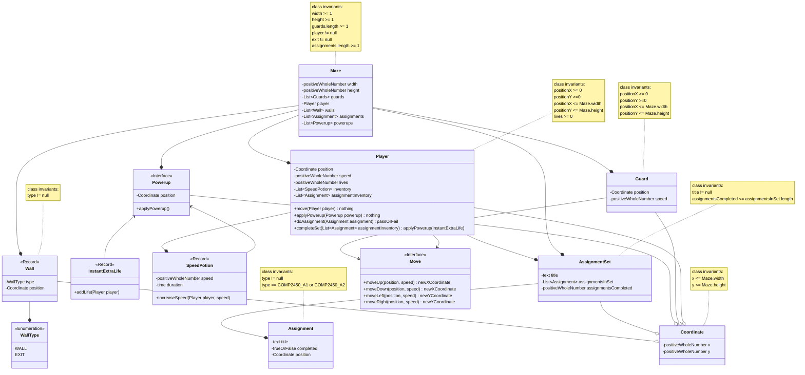

# Domain model

## Resources

* https://en.wikipedia.org/wiki/Read%E2%80%93eval%E2%80%93print_loop
* https://medium.com/@itay.gold/java-record-vs-interface-10fb193c14df
* https://help.bizzdesign.com/articles/#!horizzon-help/setting-the-aggregation-kind-of-a-uml-association-relationship
* https://contentlabstudy.com/soft/c-record-methods/
* https://stackoverflow.com/questions/5762491/how-to-print-color-in-console-using-system-out-println
* https://www.geeksforgeeks.org/java/how-to-solve-java-lang-classnotfoundexception-in-java/

## Diagram

For the domain model, the Maze class acts as a main game object, holding each of the other instances in it such as walls, guards, assignments, and the player. It stores its own width and height, and ensures that at least one of the required instances exists, and that there is only one exit wall. The walls can be either solid or an exit. The player class contains all of its actions, ensures that it stays within the bounds of the map, and has an inventory for holding assignments and save-for-later powerups (the SpeedBoost). The open diamonds represent an aggregation, the closed diamonds represent a composition, and the arrowheads represent an implementation. Here is the diagram for my domain model:

